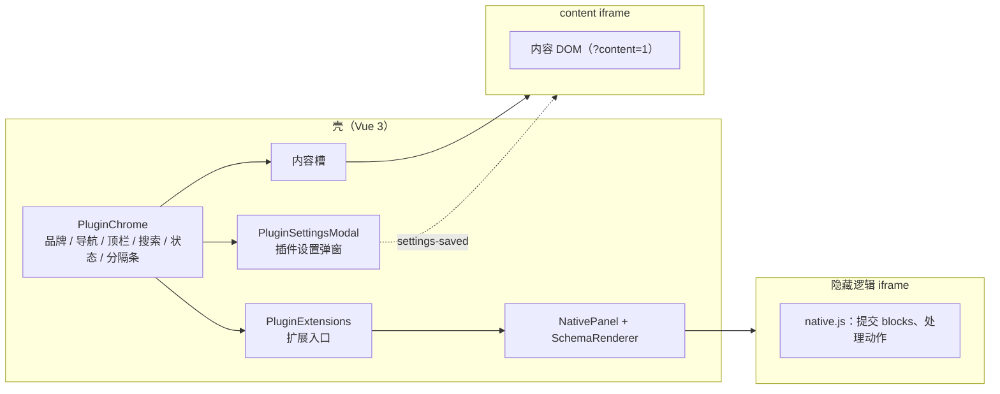

# 插件页面架构

> 页面骨架由壳渲染，插件 iframe 只提供内容；附属插件用壳的组件渲染 native 面板。

## 1 结论

OmniBox 的插件页面不再各自实现品牌块、侧栏、导航、顶栏、搜索与状态栏。manifest 声明
`frontend.chrome` 后，壳用 `PluginChrome` 渲染唯一的页面骨架，插件只保留内容；需要复杂自绘的
页面保留 content iframe，文字/表单/表格/卡片类附属页面用 native schema 由壳渲染。

这套结构覆盖 5 个侧栏插件与 2 个附属插件：

| 插件 | 页面骨架 | 内容 |
| --- | --- | --- |
| image-viewer | 壳 | content iframe：相册、justified 网格、灯箱 |
| document-reader | 壳 | content iframe：书架、阅读器、朗读设置整页 |
| manga-library | 壳 | content iframe：书架、下载中心、阅读器 |
| media-player | 壳 | content iframe：舞台、播放条、歌词、队列、EQ、列表 |
| group-mesh | 壳 | content iframe：身份、名单、共享项、远端、路线图 |
| image-cleaner | 壳 | native 面板：分组复选框、缩略图、进度 |
| pixiv-sync | 壳 | native 面板：状态、任务、OAuth、确认 |

## 2 结构



- **壳**：`PluginChrome` 渲染页面骨架；`PluginExtensions` 从 `system_get_plugin_extensions`
  取入口；`NativePanel` 用隐藏逻辑 iframe 提交的 blocks 渲染 native 内容。
- **插件设置弹窗**：壳的 `PluginSettingsModal` 盖住整个壳文档（含导航栏），schema 与值来自
  `<插件>__get_settings_schema` / `<插件>__get_settings`，保存在 `<插件>__save_settings`；
  保存成功后壳向内容 iframe 发 `omnibox:action: settings-saved`（native 目标发给隐藏逻辑页）。
  内容页不再自绘设置弹窗。
- **content iframe**：只保留内容，加载时带 `?content=1`；不得出现
  `.view-sub-sidebar`、`.view-toolbar`、`.sub-sidebar-brand`、`.obx-nav-item`。
- **native 面板**：附属插件声明 `native: {url, title}`；壳把 `NativePanel` 放进宿主
  `PluginChrome` 的内容槽，宿主侧栏/顶栏保留，内容 iframe 用 `v-show` 隐藏但实例不销毁；
  面板不再画自己的头部，标题与页面级动作（`omnibox:schema.toolbar`）都进宿主顶栏；退出走
  左侧导航或再次点当前扩展入口。入口选中态与主导航由 `PluginChrome.activeExtensionId` 统一维护。
- **侧栏顺序**：`frontend.chrome.sidebarOrder` 用 `nav:<组id>` 与 `extensions` 声明 section 顺序；
  缺省按 nav 数组序、扩展收尾。媒体播放器把 `extensions` 放首位，图片相册放末位；扩展入口与
  导航组共用同一个滚动容器。
- **分隔条**：侧栏/内容之间的分隔条由壳持有。内容 iframe 是壳文档里的子节点，无法再盖住
  指示线或吃掉热区；内容内部的分隔条（媒体舞台高度）仍由内容自己使用 `splitter.js`。

## 3 chrome 声明

`manifest.json` 的 `frontend.chrome`：

```json
{
  "brand": { "icon": "icon:images", "title": "图片相册", "subtitle": "Gallery", "accent": "#0ea5e9" },
  "nav": [
    {
      "section": "浏览",
      "items": [
        { "id": "albums", "label": "全部相册", "icon": "icon:layout-grid" },
        { "id": "latest", "label": "最近添加", "icon": "icon:sparkles", "badge": "14" }
      ]
    }
  ],
  "toolbar": [
    { "id": "settings", "label": "设置", "icon": "icon:settings" }
  ],
  "search": { "placeholder": "搜索相册…" },
  "status": true,
  "freshness": { "unit": "张" },
  "extensions": { "placement": "sidebar", "title": "扩展" }
}
```

字段说明：

| 字段 | 作用 |
| --- | --- |
| `brand` | 品牌图标、标题、副标题与渐变第二色 |
| `nav` | 分组导航；`id` 是视图标识，`visible` / `badge` 可由运行期覆盖 |
| `toolbar` | 顶栏动作；`variant`（default/primary/danger）、`kind`（button/text/badge）、`visible` / `disabled` / `active` |
| `search` | 壳渲染搜索框，输入经 `omnibox:query` 下发；内容页可用 `value` / `clear` 回填或清空输入框 |
| `status` | `true` 或 `{kind: dot-text|eq-text, items[]}`（缺省 `dot-text`；`text` 已删除） |
| `freshness` | 壳挂载统一「同步 / 校验」控件 |
| `extensions` | 壳渲染扩展入口；native 入口打开面板，view 型入口下发视图 |

`frontend.chrome.content` 字段已移除：内容形态由两件事决定 —— 是否声明 `frontend.chrome`
（声明后 iframe 加载内容页、壳渲染骨架，未声明的残留插件维持整页模式），以及附属插件
`get_extensions()` 是否返回 `native`（决定壳是否渲染 `NativePanel`）。壳不再读取任何
内容归属枚举。

运行期用 `omnibox:chrome` 打补丁：`title` / `subtitle` / `view` / `actions` / `nav` /
`search` / `status` / `statusItems`。壳只合并声明，不解释业务。

## 4 消息

壳与内容 iframe 之间（同源 `postMessage`）：

| 方向 | 消息 | 用途 |
| --- | --- | --- |
| 壳 → 内容 | `omnibox:view` | 切换视图；复合 id（如 `downloads:all`）由内容自行解释 |
| 壳 → 内容 | `omnibox:action` | 顶栏动作；可带 `payload`。声明 `frontend.chrome` 的插件，`settings` 由壳接管、不下发 |
| 壳 → 内容 | `omnibox:action`（`settings-saved`） | 壳内设置弹窗保存成功；内容页重读设置并刷新当前视图 |
| 壳 → 内容 | `omnibox:query` | 搜索输入（壳侧 250ms 防抖） |
| 壳 → 内容 | `omnibox:appearance` | 本插件背景不透明度、是否跟随壳、壳全局值；内容页据此让出底色 |
| 内容 → 壳 | `omnibox:ready` | 握手，壳补发当前视图 |
| 内容 → 壳 | `omnibox:chrome` | 标题、视图、动作、导航、搜索、状态补丁；`search.value` 回填输入框，`search.clear`（递增序号）清空 |
| 内容 → 壳 | `omnibox:open-settings` | 内容页自己的设置入口请求壳开弹窗（如歌词页右上角）；可选 `title` |
| 内容 → 壳 | `omnibox:get-plugin-appearance` | 内容页拉取本插件的背景不透明度（设置页打开时） |
| 内容 → 壳 | `omnibox:set-plugin-alpha` | 内容页写本插件背景不透明度；`follow: true` 表示跟随壳 |

native 面板：

| 方向 | 消息 | 用途 |
| --- | --- | --- |
| 逻辑页 → 壳 | `omnibox:native-ready` | 就绪 |
| 壳 → 逻辑页 | `omnibox:native-init` | 开始取数并提交 blocks |
| 逻辑页 → 壳 | `omnibox:schema` | `{blocks}` |
| 壳 → 逻辑页 | `omnibox:native-action` | `{action, payload}`，payload 在发送前做 JSON 克隆 |
| 逻辑页 → 壳 | `omnibox:native-error` | 内容加载失败 |

## 5 native 内容

`SchemaRenderer` 的组件词汇：

| 组件 | 用途 |
| --- | --- |
| `text` / `heading` | 段落与区块标题 |
| `kv` / `table` | 只读键值与表格 |
| `list` / `cards` | 列表行与卡片；支持缩略图、徽标、动作 |
| `checkbox-list` | 分组复选框文件列表（相册清理、批量选择） |
| `form` | 设置表单；字段沿用设置 schema 的类型 |
| `actions` | 动作组 |
| `progress` | 长任务进度与取消 |
| `empty` | 空态与错误态 |
| `image-grid` | 只读图片网格 |

规则：native 内容不接收任意 HTML；交互只回传动作标识；需要富文本、画布或视频的内容继续用
content iframe。附属插件不读宿主窗口上的对象，宿主能力走 Bridge / HostChannel。
逻辑页统一用 `/shell/native-client.js` 的 `NativeExtension.create({ onInit, onAction, onDispose })`：
ready 重试、init、schema、action、error 与 pagehide 清理由客户端处理，插件只写业务取数与 blocks。

### 5.1 设置字段契约（SchemaField）

唯一前端类型是 `shell/frontend/src/core/plugin-content.ts` 的 `SchemaField`（以及
`SchemaFieldOption` / `SchemaFieldValue` / `SchemaFieldCondition`）。两个壳内渲染路径共用它：
`PluginSettingsModal` 渲染后端 `settings_schema`，`SchemaRenderer` 渲染 native `form` blocks；
内容页 `base.js` 的 `createSettingsForm` 也读取同一份字段 JSON，但没有 TypeScript 类型。

| 字段 | 壳弹窗 `PluginSettingsModal` | native `form` / `SchemaRenderer` | 内容页旧表单 `base.js` |
| --- | --- | --- | --- |
| `key` / `label` / `type` / `placeholder` / `options` | 使用 | 使用 | 使用 |
| `value` | 初始值回退（`get_settings` 优先） | 初始值（`value` 优先） | 仅 `info` 使用；普通字段用 `default` |
| `default` | 使用 | 使用 | 使用 |
| `help` / `hint` | 使用（`hint` 回退） | 使用 | 只用 `help` |
| `min` / `max` / `step` | 设为控件属性；`min`/`max` 另由后端校验 | 同左 | 同左 |
| `secret` | password；打开置空；勾选「清除已保存的凭据」提交空串（清除） | password；无清除控件 | 普通 text；掩码回填；清空输入框提交空串（清除） |
| `admin_only` | 不置灰、不隐藏 | 不置灰、不隐藏 | 不置灰、不隐藏 |
| `hidden` | 读取时过滤掉 | 不判断 | 跳过 |
| `multi` / `emptyText` | `multi`、`emptyText` 使用 | `multi` 使用；`emptyText` 不使用 | `FolderPicker` 使用 |
| `local_only` | `FolderPicker` 隐藏「网络位置」 | `FolderPicker` 隐藏「网络位置」 | `FolderPicker` 隐藏「网络位置」 |
| `required` | 只加标签样式 | 不判断 | 只加标签样式 |
| `info` | 只读展示，不提交 | 只读展示，不提交 | 只读展示，不提交 |
| `condition` / `save_target` | 不消费 | 不消费 | 不消费 |

`min` / `max` 的最终判定在后端 `PluginBase.save_settings`：number/range 接受数字或数字字符串并
归一化，布尔值不算数字；缺失或非有限数字视为该侧无边界；与旧值相同则直接放行（历史越界值
不会因打开设置就被拒）；越界返回 `{success: false, error, errors}`，整次调用不落盘。`step`
只作用于前端控件，后端不校验。

`secret`：`get_settings()` 对非空值返回掩码 `********`；提交掩码 = 不改动，提交空字符串 =
清除，提交其它非空值 = 覆盖。三个前端入口都能完成清除：`PluginSettingsModal` 打开时把
secret 输入框置空，并给出「清除已保存的凭据」勾选框，勾选后提交空字符串；未勾选且输入框
仍为空时省略该键（不改动），填写新值则覆盖。内容页 `base.js` 与 native `form` 没有专用
清除控件，清空输入框提交空串即清除。清除能力不依赖迁移阶段。

**native 设置已由壳的设置弹窗接管**：`image-cleaner` 与 `pixiv-sync` 的原生面板不再构造
settings blocks，也不在面板内渲染表单。native 顶栏的「设置」动作（`open-settings`）由壳拦截，
用 `PluginSettingsModal` 按插件的 `settings_schema` 渲染（目标记为 native，不显示外观块）；
保存成功后壳向隐藏逻辑页发 `settings-saved`，逻辑页重读状态。字段级 `errors` 由弹窗按 schema
key 显示到对应输入框。`pixiv-sync` 的 `refresh_token` 是 `secret`，清除走弹窗的「清除已保存的
凭据」；原生面板仍保留「清除 Token」内容动作作为账号级快捷入口。native `form` block 仍存在
（`SchemaRenderer` 的组件词汇之一，pixiv-sync 用它收 OAuth 授权码），但不再承载插件设置。

`admin_only` 只由后端判定（当前主体不是管理员即拒绝，缺少主体的 CLI/用例放行），三个前端入口
都不置灰、不隐藏；`info` 在前端不提交、后端也不列入可写键。`condition` 与 `save_target` 是类型
里的预留字段，当前没有任何消费方；`required` 只做标签样式，不做提交校验。

## 6 统一保证

- **页面骨架只有一份**：五个侧栏插件的 brand/nav/toolbar/search/status 都由
  `PluginChrome` 渲染；插件删除自己的 chrome DOM 与 CSS。
- **分隔条只有一份**：壳持有侧栏分隔条，内容 iframe 的 z-index 不再参与壳文档的层叠。
- **扩展入口只有一份**：`PluginExtensions` 从后端取入口；宿主不再自建 `#iv-extensions` /
  `#mp-extensions`。
- **刷新控件只有一份**：`freshness.js` 由壳挂载，内容页通过 `refresh` 动作重载。
- **设置弹窗只有一份（除 image-viewer 外）**：声明 `frontend.chrome` 且设置能由
  `settings_schema` 表达的插件，顶栏「设置」由壳打开 `PluginSettingsModal`；内容页只处理保存
  后的 `settings-saved`。`image-cleaner` / `pixiv-sync` 的 native 设置同样走这个弹窗：native
  顶栏的「设置」动作由壳拦截，隐藏逻辑页只重读 `settings-saved`。image-viewer 例外，设置仍在
  内容页。壳内设置页与 image-viewer 的内容设置页顶部还有一块通用「外观」：背景不透明度与
  「跟随壳透明度」，值存在壳偏好 `--plugin-glass-<插件名>` 里，不写进插件 `settings_schema`。
  image-viewer 通过 `omnibox:get-plugin-appearance` / `omnibox:set-plugin-alpha` 读写同一份偏好；
  附属插件的 native 面板不显示外观块（它没有自己的页面骨架）。
- **搜索输入只有一份**：壳持有输入框；内容页切视图、进二级页时用 `search.clear` 复位，
  需要程序化回填时用 `search.value`，不另建搜索框。
- **状态栏的迷你 EQ 归壳**：`status.kind = eq-text` 时，播放中（`state=ok`）由
  `PluginChrome` 渲染四柱动画，内容页只上报状态。
- **主题跟随**：骨架使用壳的 CSS token，用户改圆角、动效、强调色、侧栏宽度时同步生效。
- **契约可验收**：`tools/plugin_ui_audit.py` 起真实壳逐插件检查壳 chrome、内容页无 chrome
  标记、导航与标题同步、分隔条 hover、freshness 与控制台错误。

## 7 设计取舍

- **壳用 Vue，内容页不用前端框架**：壳承载响应式状态、路由、iframe 生命周期与 native
  schema 渲染；插件内容页保持静态，第三方插件免构建即可加载。把 Vue 塞进每个 iframe 会
  增加构建与版本耦合，且一致性来自 chrome 归属，不来自框架统一。
- **内容 iframe 保留给画布**：相册网格、阅读器、播放舞台这类页面自绘成本高、差异是语义，
  不强行 schema 化；它们仍使用壳注入的内容组件。
- **附属插件用壳组件，不借宿主 DOM**：`replace` 面板由壳渲染，宿主 iframe 隐藏；需要宿主
  能力时走 Bridge，避免跨 iframe 读取宿主对象。
- **旧 embed 入口保留**：不认 `native` 的旧壳仍可回落到 `embedUrl`，新壳优先 native。

## 8 已知边界

- image-viewer 的设置仍在内容 iframe 内（`openSettingsModal`）：它按目录作用域读写，
  还带根目录列表控件，单份 `settings_schema` 表达不了；壳内设置弹窗服务其余插件（含两个
  附属插件的 native 设置）。它的外观块通过消息读写壳偏好，设置保存仍走内容页。
- 插件背景默认跟随壳的 `--glass-alpha`；单独覆盖时只改页面骨架与内容页公共区域，插件
  自己写死的卡片仍按各自样式绘制。native 面板沿用宿主插件的覆盖值。
- 插件的 `directory` 字段（壳弹窗、native form 与内容页旧表单）统一由壳内共享
  `FolderPicker`（`shell/frontend/public/shell/folder-picker.js`）渲染：路径行 + 「浏览…」
  走 `system_browse_dir`，`local_only: true` 的字段不显示「网络位置」按钮，其余字段可由
  network-location 提供方把远端共享项取到本地目录后回填。插件目录字段不再使用系统目录
  对话框（`system_pick_path('directory')`）；`system_pick_path` 只剩壳自己的设置页选图片。
- native 预览使用插件给的缩略图 URL，没有单独的原图字段；需要原图时再扩展 schema。
- image-cleaner 的根目录在后端仍是 `info` 字段，壳设置弹窗里保存的是图片相册的 `root_dir`；
  多根时只编辑主根，其余根仍到图片相册设置里管理。
- 设置弹窗、搜索回填与 EQ 尚未纳入 `tools/plugin_ui_audit.py`；本轮用一次性 Selenium
  探针验收，后续应把这三项写成可重复的门禁。
- 迁移前的逐插件 UI e2e 已按壳 chrome 重写（内容页改发 `omnibox:view` / `omnibox:action`，分隔条改量壳侧栏）；CI 不安装 selenium，这些用例会跳过。
- 新增插件仍按「chrome 声明」「消息」「native 内容」三节手工接入；脚手架与组件预览页尚未接入。

## 9 验证

```bash
npm --prefix shell/frontend run build
venv/Scripts/python.exe tools/check_plugins.py
venv/Scripts/python.exe tools/check_docs.py
venv/Scripts/python.exe tools/plugin_ui_audit.py
venv/Scripts/python.exe -m unittest discover -s tests -p 'test_*_js.py'
```

审计工具支持 `--plugin`、`--base-url` 与 `--json`；失败退出 1，环境错误退出 2；不截图，
断言全部来自 DOM、计算样式与 rect。
