<div align="center">

# 格子铺（Cubby）

**一个窗口，装下你的图片、漫画、音乐和文档**

本地优先 · 插件化 · 数据与程序分离

[](./LICENSE)
[](#下载与安装)
[](https://github.com/Flotiarenor/Cubby/releases)

[下载](#下载与安装) · [内置插件](#内置插件) · [常见问题](#常见问题) · [开发者文档](./docs/development.md)

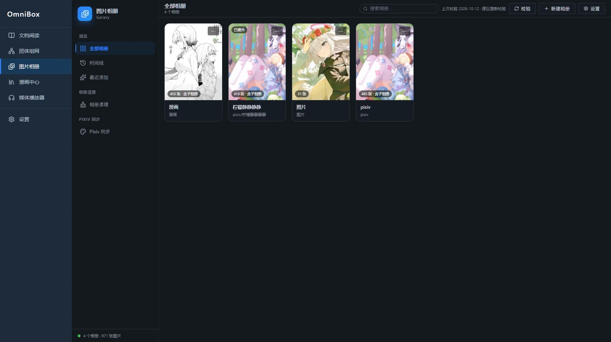

</div>

## 这是什么

格子铺是把散在本机各处的东西收进同一个窗口：图片相册、漫画书架、音乐与视频库、文档阅读器。

它本体只是一个窗口和插件容器，**能力全部来自插件**——内置 8 个插件随发行包提供，装上即用；第三方插件放进用户数据目录下的 `plugins/` 就加载。

- **文件留在你自己机器上**：程序默认只监听 `127.0.0.1`，本身不需要任何账号；除你主动使用的在线功能（网易云音乐、Pixiv 同步、文档朗读的 edge-tts 端点、团体组网的公网 IPv6 文件共享）外，不向外部服务器发送数据。
- **升级不用搬数据**：配置、索引与缓存在独立的用户数据目录（Windows `%LOCALAPPDATA%\Cubby`、Linux `~/.local/share/cubby`），程序目录只放只读资源；换版本只替换程序，数据留在原处。要带着数据走时用便携版，并在程序旁放一个 `portable.txt`。

## 内置插件

| 插件 | 能做什么 |
| --- | --- |
| **图片相册** `image-viewer` | 多个图片目录、按文件夹聚合的相册、混合瀑布流、时间线（按相册 / 按图片）与幻灯片浏览 |
| **重复图片清理** `image-cleaner` | 挂在图片相册里：扫描全部相册中的重复 / 相似图片 |
| **Pixiv 同步** `pixiv-sync` | 挂在图片相册里：同步下载关注画师的新作与收藏画作 |
| **漫画中心** `manga-library` | 书架浏览、章节阅读、收藏与最近阅读，以及下载任务管理 |
| **媒体播放器** `media-player` | 音乐/视频专辑、最近播放、混编歌单、歌词沉浸页、EQ 与全屏播放 |
| **网易云音乐** `netease-music` | 挂在媒体播放器里：基于网易云官方cli的在线音乐播放接口 |
| **文档阅读** `document-reader` | 本地文档目录的读写与朗读 |
| **团体组网** `group-mesh` | 无中心团体组网：身份、团体名单、共享节点与加密传输 |

图片相册、漫画中心、媒体播放器、文档阅读、团体组网在左侧导航栏里各有入口；重复图片清理、Pixiv 同步、网易云音乐是 **Companion 插件**，没有独立导航项，入口挂在宿主插件内部——比如在图片相册里打开「相册清理」或「Pixiv 同步」，在媒体播放器里切到网易云音乐。

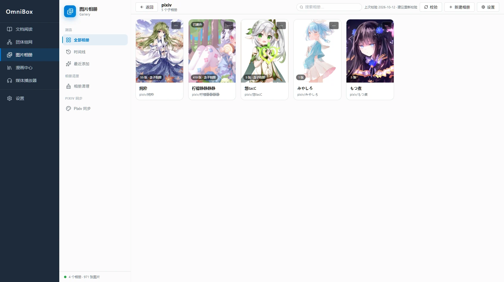

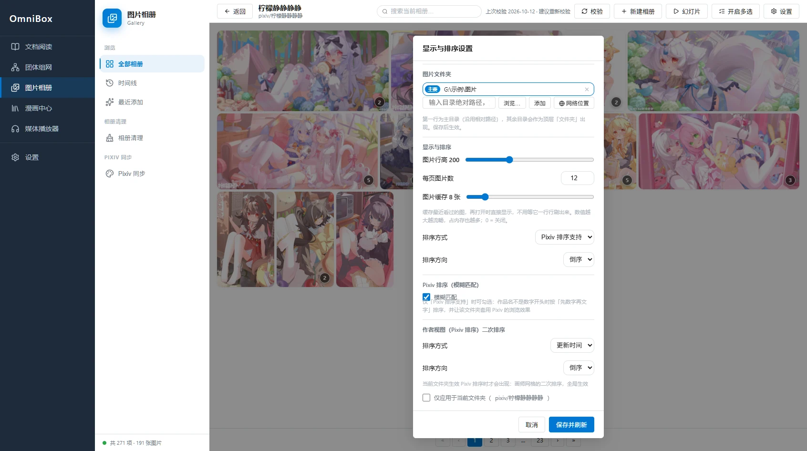

## 界面速览

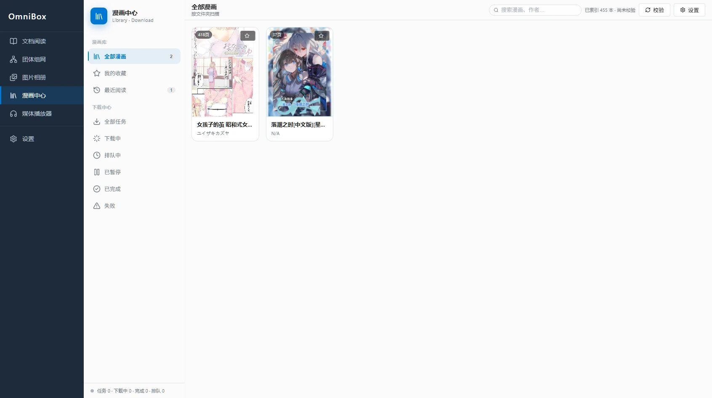

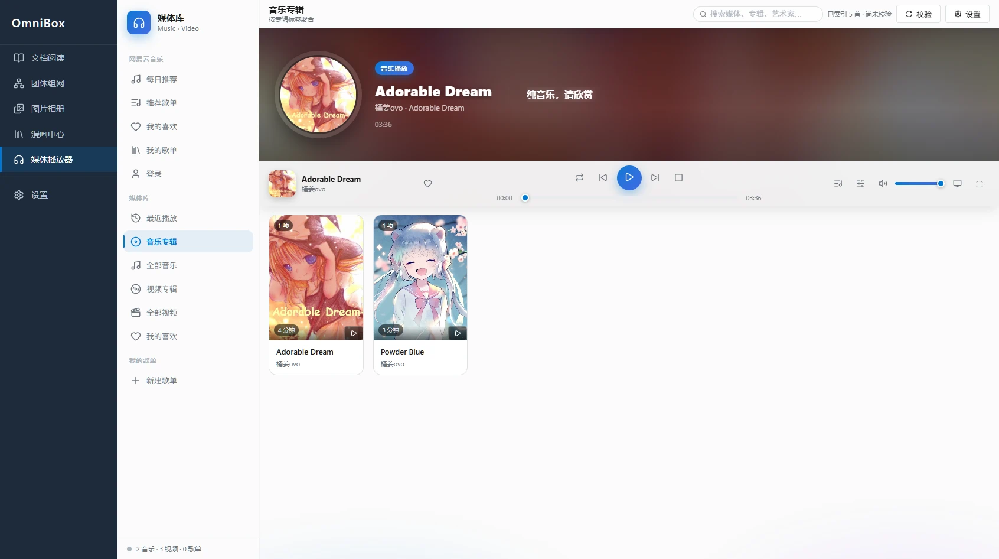

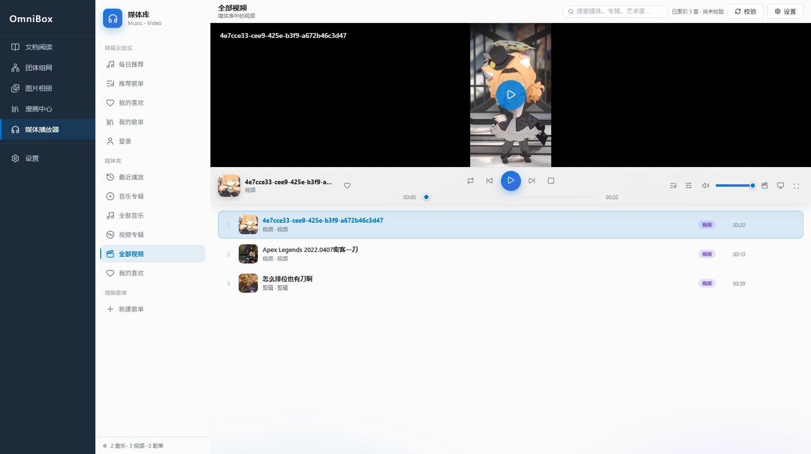

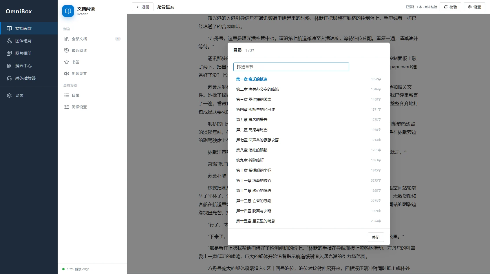

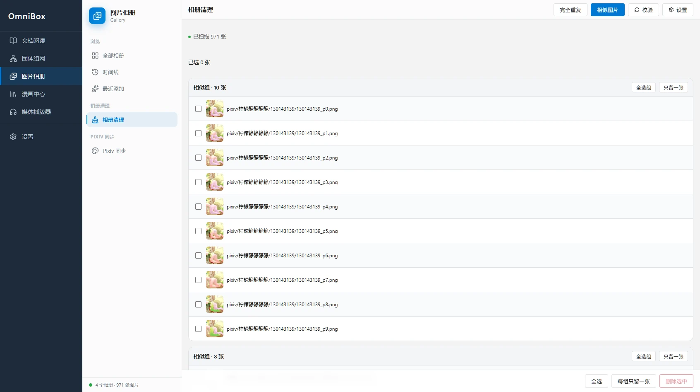

## 接上在线服务

两个 Companion 插件把在线内容接进本地库：**Pixiv 同步**把关注画师的新作与收藏画作下载进图片相册（按画师聚合成子相册，重复作品按 Pixiv 作品 ID 自动跳过）；**网易云音乐**在媒体播放器里提供每日推荐、推荐歌单与我的歌单。

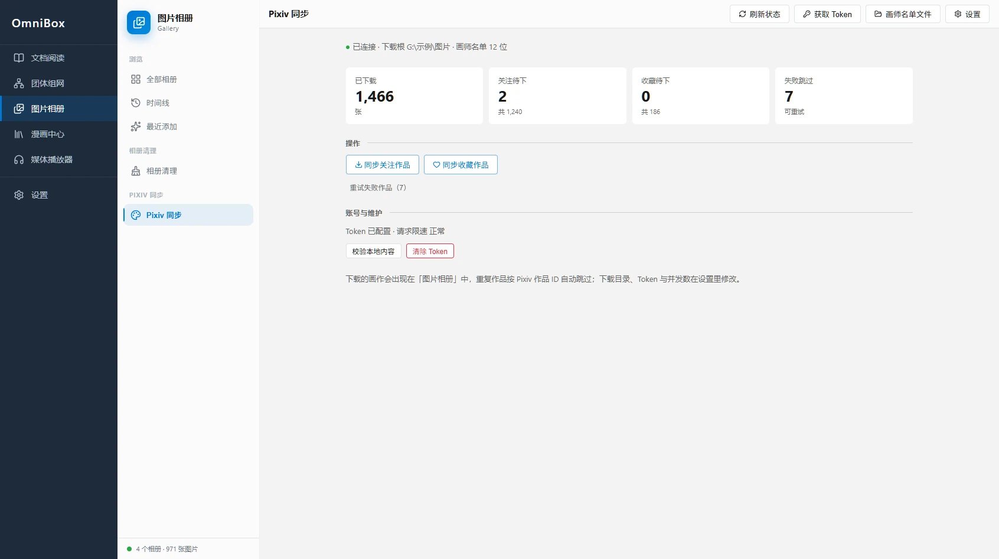

## 下载与安装

到 [Releases](https://github.com/Flotiarenor/Cubby/releases/latest) 下载对应平台的产物：

| 平台 | 产物 | 启动方式 |
| --- | --- | --- |
| Windows x64（推荐） | `Cubby-Setup-<版本>.exe` | 双击安装，从开始菜单启动 |
| Windows x64（便携版） | `Cubby-windows-x64.zip` | 解压后双击 `Cubby.exe` |
| Linux x64 | `Cubby-linux-x64.tar.gz` | 解压后 `cd Cubby && ./Cubby --web-only`，用浏览器访问 |

每次发布同时提供 `.sha256` 校验文件，可用于核对下载是否完整：

```powershell
# Windows：与同名的 .sha256 文件比对，输出 True 表示一致
$expected = (Get-Content .\Cubby-Setup-<版本>.exe.sha256).Split(' ')[0]
(Get-FileHash .\Cubby-Setup-<版本>.exe -Algorithm SHA256).Hash -eq $expected
```

```bash
# Linux
sha256sum -c Cubby-linux-x64.tar.gz.sha256
```

**安装版（Windows）三步走**：

1. 下载 `Cubby-Setup-<版本>.exe`；
2. 双击安装（装到当前用户，不需要管理员权限）；
3. 从开始菜单启动。升级时重复前两步即可，覆盖同一个安装位置，**你的数据不用搬**。

**压缩包（Windows zip / Linux tar.gz）三步走**：

1. 下载对应压缩包；
2. **完整解压**到你有写权限的目录（例如 `D:\Cubby`、`~/cubby`）；
3. 运行可执行文件。Linux 用 `cd Cubby && ./Cubby --web-only` 起服务、浏览器访问；Windows 双击 `Cubby.exe`。

> Windows 便携版默认也把数据写在用户数据目录。想让数据跟随程序目录（U 盘、多份副本），
> 在 `Cubby.exe` 旁新建一个空的 `portable.txt` 再启动。完整规则见
> [安装与更新](./docs/install-and-update.md)。

两个必须提前知道的事：

- 程序把配置、索引与缓存写在**用户数据目录**（Windows `%LOCALAPPDATA%\Cubby`、Linux `~/.local/share/cubby`），不在安装目录里，所以升级或换版本不用搬数据。**别把跑过便携模式或从源码运行的目录再打包发给别人**——那里会有你的配置和数据。
- 可执行文件与安装器均未做代码签名，Windows 首次运行可能被 SmartScreen 拦下：点「更多信息」→「仍要运行」。

## 用浏览器访问（NAS / 服务器 / 局域网）

不想开桌面窗口时，可以只跑后端，用浏览器访问：

```bash
python main.py --web-only        # 默认 http://127.0.0.1:18080
```

`/api`、`/file`、`/thumbs` 等数据路由受访问令牌保护：令牌在首次启动时生成并写入数据目录下的 `.config/auth_token.txt`（从源码运行时就是项目根的 `.config/`，重启不变），浏览器页面会自动种下 HttpOnly Cookie，外部脚本调用时带上请求头即可：

```bash
curl -H "X-Cubby-Token: $(cat .config/auth_token.txt)" \
     -X POST http://127.0.0.1:18080/api/system_get_config
```

> 需要公网访问时，请经 nginx 之类的反向代理自行加一层 HTTPS 与访问控制；不要把令牌文件和端口直接暴露到不受信任的网络。

## 安装与卸载插件

1. 把插件文件夹放进用户数据目录下的 `plugins/`（从源码运行时是项目根目录的 `plugins/`）；
2. 重启应用，插件出现在导航栏里；
3. 删除文件夹重启即卸载插件

插件由第三方提供，安装后与主程序拥有同样的权限：它和程序一起运行，能在你这台机器上读写文件、访问网络。只安装来源可信的插件，装之前先确认它从哪里来。想了解具体机制，见[插件开发指南](./docs/plugin-guide.md)的「插件是受信代码」。

插件可以自带纯 Python 依赖（放在其 `backend/libs`），不装进主环境，删除目录即卸载干净。

## 常见问题

**需要联网吗？**
相册、漫画、媒体库、文档阅读都是纯本地功能，断网可用。联网只发生在你主动使用在线功能时：网易云音乐与 Pixiv 同步访问各自的在线服务，文档朗读把待读文本发往 edge-tts 语音端点等。

**我的数据存在哪里？怎么备份或迁移？**
配置在 `.config/`、索引与缓存在 `data/`，两者都在**用户数据目录**下：Windows 是 `%LOCALAPPDATA%\Cubby`，Linux 是 `~/.local/share/cubby`。安装目录里没有你的数据，升级不用搬。

- **备份**：关掉程序，把整个数据目录拷走。`.config/` 内含本机访问令牌，分享给别人前先删掉。
- **迁移到另一台机器**：把数据目录放到同样的位置，或用环境变量 `CUBBY_HOME` 指向它。
- **便携模式（跟着程序走）**：在 `Cubby.exe` 旁放一个空的 `portable.txt`，数据就落在程序目录旁，整个目录拷走即迁移。

解析顺序与设计取舍见 [安装与更新](./docs/install-and-update.md)。

**会改动我的原始文件吗？**
相册、漫画库、媒体库都只是按目录建立索引，不改动原文件；程序产生的索引与缩略图缓存在 `data/` 下，可在「设置 → 数据与缓存」里查看占用并清空。

**支持 macOS 或手机吗？**
目前只发布 Windows 与 Linux 产物。Web 模式可以用手机浏览器打开，但界面是按桌面尺寸设计的。

**界面能改成什么样？**
「设置 → 外观」提供浅色/深色、界面圆角、导航栏宽度、**各插件内边栏宽度**、动效开关，以及 13 项 CSS 变量级颜色自定义；改动会自动同步到所有插件页面。「设置 → 背景」是独立的一节：从图片库里选一张壁纸，调显示方式（cover / contain / 平铺 / 自由）、位置、缩放与镜像，再用玻璃效果决定面板透出多少。

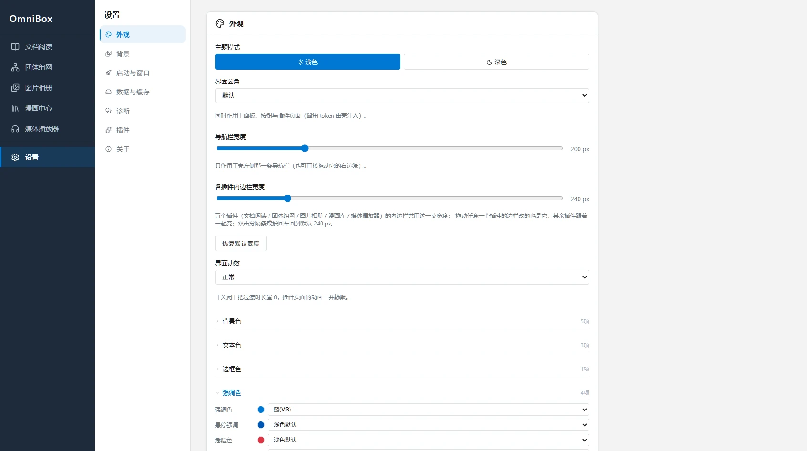

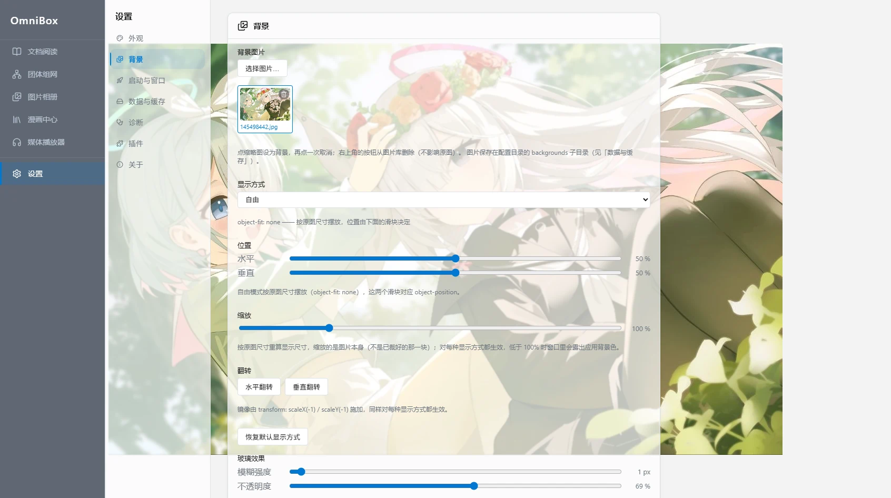

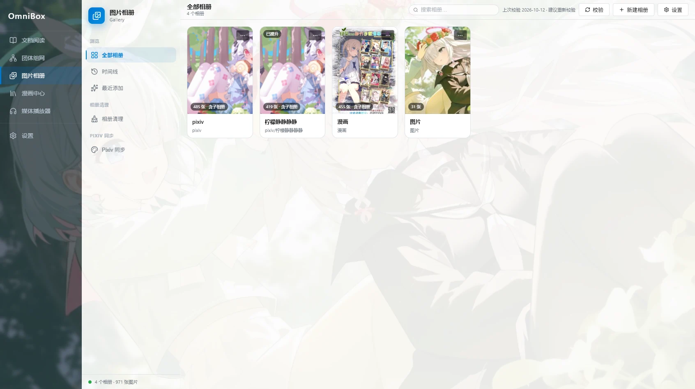

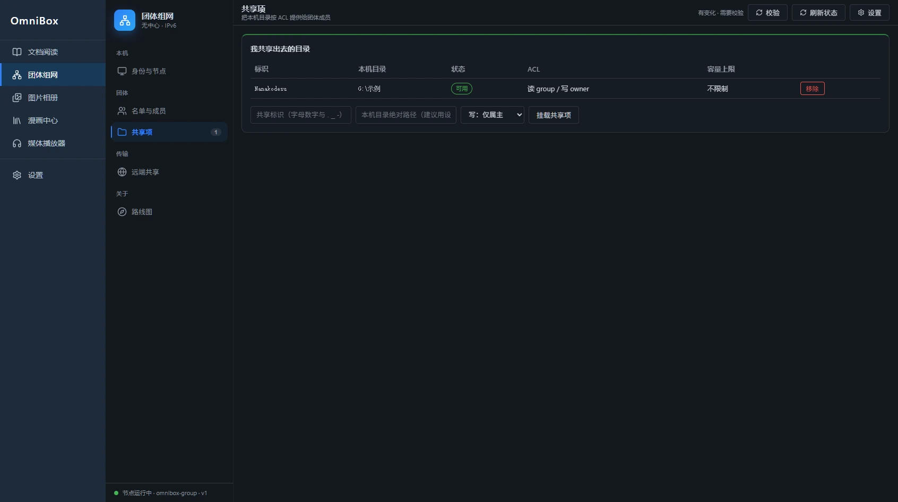

**为什么功能都拆成插件？**
主程序只负责窗口、导航、插件加载与文件服务的路径安全，业务能力全部下沉到插件：插件与主程序独立开发、独立构建，前端技术栈自由（Vue、React 或纯 HTML 都行），单个插件损坏也不会拖垮主程序。

## 开发者

- [开发文档](./docs/development.md)：架构概览、从源码运行、调试、打包发布与 CI 门禁
- [安装与更新](./docs/install-and-update.md)：数据根与安装目录的分离、Windows 安装器、Linux 分发与检查更新的边界
- [插件开发指南](./docs/plugin-guide.md) / [插件界面指南](./docs/plugin-ui-guide.md)
- [插件页面架构](./docs/plugin-page-architecture.md)：壳渲染的品牌/导航/顶栏/搜索/状态/分隔条，content iframe 只装内容，附属插件的 native 面板由壳渲染
- 插件页面骨架验收：`python tools/plugin_ui_audit.py`（需已构建的前端、Chrome 与 selenium，见 [tools/AGENTS.md](./tools/AGENTS.md)）
- 一键生成插件骨架：`python tools/new_plugin.py my-tool`

## 许可证与反馈

本项目基于 **Apache License 2.0** 开源，详见 [LICENSE](./LICENSE)。

问题与建议请提 [Issue](https://github.com/Flotiarenor/Cubby/issues)，欢迎 PR。

文档截图里出现的作品和缩略图版权归各原作者所有，仅作界面演示之用。作者本人或权利人如不希望作品出现在本文档中，提 Issue 说明是哪一张，维护者会立即撤下并重拍；出处登记与移除通道见 [docs/images/README.md](./docs/images/README.md)。
